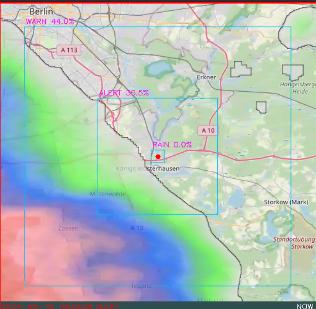
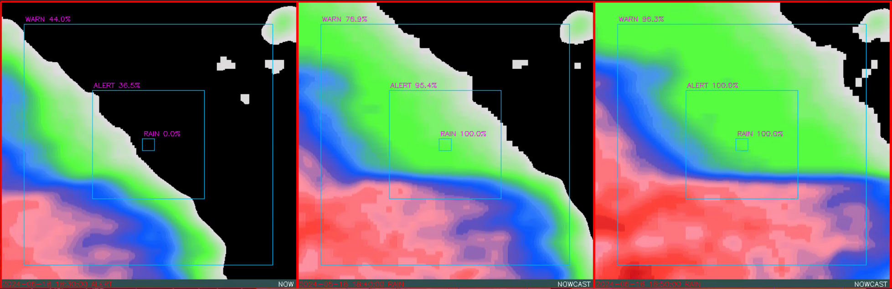

# weather_alert
 Weather alert package is based on Rainwiever API. [https://www.rainviewer.com/api.html](https://www.rainviewer.com/api.html)

 Monitors rain based on radar data from API and publishes ROS messages with 60 minute history and 30 minute forecast every 10 minutes. It can help the robot to hide from the rain in time. Or don't go out at all when it's raining or there's a high probability that it will.

 You can run it standalone or as ROS node and use it for rain forecast on your robot. It's made for VITULUS robot, but can be run on other robots too.

 For map support clone [docker-mapproxy](https://github.com/lacina-dev/docker-mapproxy) and run docker container.

 Follow the comments in the config/config.yaml and adjust lat, lon, etc. for your needs.

 ### Radar sources
 Select the source with `general.source` in `config/config.yaml` (or override it in `config/config.local.yaml`):
  * `chmi` (default) – ČHMÚ open data, Czech Republic + neighbours, 5-min radar + 60-min nowcast.
  * `rainviewer` – RainViewer, global, no nowcast in the free tier.
  * `mosaic` – multi-source precipitation mosaic (ČHMÚ, OPERA, RainViewer, …) from the local
    precip-mosaic service (package `vitulus_precip`, `vitulus-precip serve`, default port 8097).
    The service must run with an area that contains your location. Settings are in the `mosaic:`
    section (`url`, `timeout_s`, `poll_s`, `rain_mmh` rain threshold in mm/h, `half_km`, …).
    The node asks `/point` for the time line and `/area.png` (`style=data` for the evaluation,
    `style=rate` for the pictures, nowcast as `frame=nowcast+N`); the 1/9/20 km frames are evaluated
    here, exactly as for `chmi`, so all topics keep their format. When the service goes down after
    frames arrived nothing new is published (the last `rain_alert` gets old), as with `chmi`; with no
    frame at all (down since the start) every poll publishes `rain_alert` with every status
    `UNAVAILABLE` and `rain_now 0`, as `chmi` does without data. A frame without radar coverage at the robot
    has status `UNAVAILABLE`, and without coverage in the NOW frame no `rain_alert` is published.
    Test offline: `python3 test/test_mosaic.py`.

 ### Standalone
 Run `python3 scripts/main.py` and then you can check if you are getting what you need. It shows you the current situation in pictures to make sure the configuration is correct.

 *Current rain situation with map and detection frames on the position you configured.*
 

 *Current rain situation and forecast.*
 

 ### ROS (Noetic tested)
 Compile this package in your catkin workspace and run
 `roslaunch weather_alert weather_alert.launch`

 Publications:
  * log_info *[std_msgs/String]*

    Short text if rain alert e.g. Rain now 100%. Published when new forecast received.

  * /weather_alert/rain_alert *[weather_alert/RainAlert]*

    Rain data in ten minute step. Now, 60 minutes to past and 30 minutes forecast. See the message.
